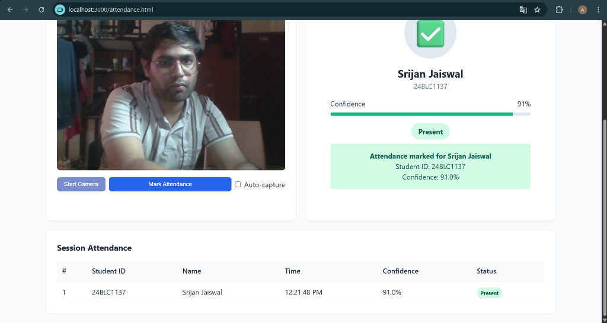
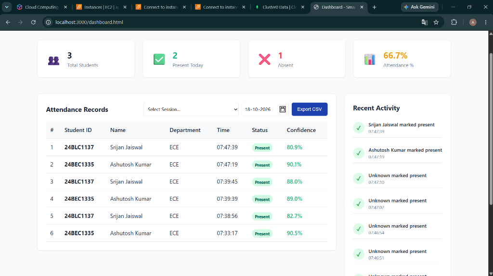
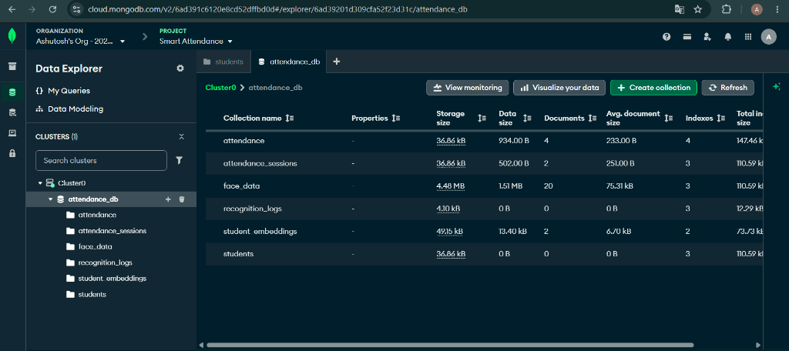

# Cloud-Based Smart Attendance System Using Machine Learning and MongoDB

[](https://www.python.org/)
[](https://fastapi.tiangolo.com/)
[-EE4C2C.svg)](https://pytorch.org/)
[-blueviolet.svg)](https://github.com/timesler/facenet-pytorch)
[-47A248.svg)](https://www.mongodb.com/)
[](https://aws.amazon.com/lambda/)

---

## 📸 Live System Demonstration

| Live Facial Recognition (90%+ Confidence) | Faculty Analytics Dashboard |
| :---: | :---: |
|  |  |

| Cloud Database Architecture (MongoDB Atlas) |
| :---: |
|  |

---

## 1. Project Overview

The **Cloud-Based Smart Attendance System** is an end-to-end computer vision and cloud computing solution that automates classroom attendance using biometric facial recognition. Instead of relying on manual roll-calls or generic third-party cloud APIs (such as Amazon Rekognition), this project implements a **custom machine learning face recognition pipeline** leveraging **FaceNet (InceptionResnetV1)** pretrained on VGGFace2, paired with **MTCNN (Multi-Task Cascaded Convolutional Networks)** for face detection and landmark alignment.

The system is architected as an academic proof-of-concept demonstrating the synergy of:
- **Computer Vision & Deep Learning**: Real-time multi-stage face detection, alignment, 512-dimensional hypersphere embedding extraction, and cosine similarity metric learning.
- **NoSQL Database Engineering**: High-performance MongoDB Atlas document store for student demographic metadata, biometric embeddings, session states, and audit logs.
- **Cloud Computing & Serverless Architecture**: AWS API Gateway (HTTP API v2) coupled with containerized AWS Lambda functions packaged via Amazon ECR to bypass standard serverless package size limitations.
- **RESTful API Design**: Modular FastAPI backend with asynchronous request handling, schema validation, and strict duplicate check-in prevention.
- **Modern Web Dashboard**: Responsive vanilla HTML5/CSS3/JavaScript interface for student registration, live camera inference, and faculty analytics.

---

## 2. Problem Statement

Traditional attendance methods in higher education institutions suffer from significant drawbacks:
1. **Time Consumption**: Manual roll calls consume 10–15% of instructional lecture time.
2. **Proxy Attendance / Buddy Punching**: Paper sign-in sheets and RFID card tap systems are easily bypassed by unauthorized peers.
3. **Data Silos**: Attendance records on physical registers or fragmented spreadsheets require tedious manual data entry and are prone to transcription errors.
4. **Third-Party Cloud API Costs & Vendor Lock-In**: Commercial APIs (e.g. AWS Rekognition, Azure Face) incur per-call subscription fees and do not provide visibility into the underlying feature representation or transfer learning pipeline.

This project resolves these challenges by building an institutionally owned, custom ML recognition engine integrated with a serverless cloud infrastructure and unified database.

---

## 3. Project Objectives

1. **Custom Biometric ML Engine**: Build a face recognition pipeline capable of extracting discriminative 512-dimensional embeddings without external cognitive APIs.
2. **Prevent Duplicate Check-in**: Guarantee that a student cannot be marked present more than once during the same active lecture session.
3. **Handle Edge Cases Gracefully**: Detect and report conditions such as zero faces in the frame, multiple faces, unknown persons, and low-confidence attempts.
4. **Dual-Mode Deployment**:
   - **Local FastAPI Mode**: Immediate local execution with zero cold starts for interactive classroom demonstrations.
   - **AWS Serverless Mode**: AWS API Gateway + Lambda Docker container deployed via Amazon ECR for scalable cloud execution.
5. **Faculty Analytics Dashboard**: Real-time monitoring of attendance tallies, present/absent ratios, and one-click CSV report exports.

---

## 4. High-Level Architecture

### End-to-End System Workflow

```
               +-------------------------------------------+
               |            Client Web Browser             |
               |  (Registration / Attendance / Dashboard)  |
               +---------------------+---------------------+
                                     |
                                     | HTTPS / REST (Base64 JPEG)
                                     v
               +-------------------------------------------+
               |            AWS API Gateway (v2)           |
               |         POST /api/recognize               |
               |         POST /api/students/register       |
               +---------------------+---------------------+
                                     |
                                     | Proxy Integration
                                     v
               +-------------------------------------------+
               |                AWS Lambda                 |
               |      (Container Image via Amazon ECR)     |
               |      Memory: 3008 MB (2 vCPUs)            |
               +----------+---------------------+----------+
                          |                     |
     Image Payload        |                     | Read / Write
                          v                     v
+-------------------------------+  +-------------------------------+
|     Custom ML Pipeline        |  |        MongoDB Atlas          |
|                               |  |          (M0 Cluster)         |
| 1. MTCNN Face Detection       |  |                               |
| 2. Landmark Alignment         |  | - students                    |
| 3. Crop & Resize (160x160)    |  | - face_data                   |
| 4. InceptionResnetV1 (512-d)  |  | - student_embeddings          |
| 5. L2 Hypersphere Normalization| | - attendance (unique index)   |
| 6. In-Memory Vectorized Dot   |  | - attendance_sessions         |
|    Product (Cosine Sim)       |  | - recognition_logs            |
+---------------+---------------+  +-------------------------------+
                |
                v Identity & Confidence
+-------------------------------+
| Attendance Orchestrator       |
| - Verify Session Status       |
| - Enforce Single-Checkin      |
| - Record Timestamped Audit Log|
+-------------------------------+
```

### Phase Separation: Training vs. Inference

- **Phase A (Student Registration & Embedding Generation - Offline)**:
  - Performed once during student onboarding.
  - Webcam captures 10–15 face samples across varied angles and lighting.
  - MTCNN detects, aligns, and crops faces to 160×160 pixels.
  - Pretrained FaceNet extracts 512-d embeddings.
  - Embeddings are averaged, L2-normalized, and stored in the `student_embeddings` MongoDB collection.
- **Phase B (Classroom Attendance - Real-Time Inference)**:
  - Triggered per camera frame during an active session.
  - Live face is detected and converted to a query vector $q \in \mathbb{R}^{512}$.
  - Rapid vectorized matrix multiplication against gallery matrix $M \in \mathbb{R}^{N \times 512}$ yields similarity scores in $< 2\text{ ms}$.
  - The highest score is compared against `RECOGNITION_THRESHOLD` ($\tau = 0.65$).
  - If satisfied, attendance is marked and logged in MongoDB.

---

## 5. Technology Stack

| Layer | Component | Version / Specification | Rationale |
|---|---|---|---|
| **Frontend** | Vanilla HTML5 / CSS3 / JavaScript | Modern ES6+, Fetch API, Canvas API | Lightweight, zero-build tooling, direct access to `navigator.mediaDevices.getUserMedia`. |
| **Backend Framework** | FastAPI | 0.111.0 | Asynchronous ASGI support, automatic OpenAPI documentation, high performance. |
| **Serverless Adapter**| Mangum | 0.17.0 | Seamlessly converts API Gateway v2 payloads into ASGI requests for FastAPI. |
| **ML Framework** | PyTorch (CPU-Only) | 2.3.1+cpu | CPU-optimized binary drastically reduces container size from 2.5 GB to ~800 MB. |
| **Face Detection** | MTCNN (`facenet-pytorch`) | 2.6.0 | Joint face detection and 5-point facial landmark alignment. |
| **Face Embedder** | InceptionResnetV1 | VGGFace2 Pretrained | Canonical Google FaceNet architecture producing 512-dimensional normalized embeddings. |
| **Database** | MongoDB Atlas (M0 Free) | pymongo 4.7.0 | Cloud document database with TLS encryption, schema flexibility, and connection pooling. |
| **Containerization** | Docker / AWS Lambda Container | Amazon Linux 2023 | Bypasses standard 250 MB Lambda zip limit (supports up to 10 GB images via ECR). |
| **Cloud Hosting** | AWS API Gateway + Lambda | ap-south-1 / us-east-1 | Pay-per-use serverless execution with automatic scaling and zero idle cost. |

---

## 6. MongoDB Schema

The system uses six collections in the `smart_attendance` database:

### 1. `students` Collection
Stores demographic information and enrollment status.
```json
{
  "_id": { "$oid": "66d8e20f12a4b8c9d0e1f2a3" },
  "student_id": "23BEC101",
  "name": "Rahul Kumar",
  "department": "ECE",
  "semester": 5,
  "section": "A",
  "email": "rahul@example.com",
  "status": "active",
  "face_samples_count": 12,
  "embedding_generated": true,
  "created_at": { "$date": "2026-09-04T09:00:00.000Z" },
  "updated_at": { "$date": "2026-09-04T09:05:00.000Z" }
}
```
*Indexes:* `{ student_id: 1 }` (Unique), `{ department: 1, section: 1 }`

### 2. `face_data` Collection
Stores raw captured face samples during registration.
```json
{
  "_id": { "$oid": "66d8e20f12a4b8c9d0e1f2a4" },
  "student_id": "23BEC101",
  "sample_index": 1,
  "image_base64": "data:image/jpeg;base64,...",
  "pose": "front",
  "face_detected": true,
  "embedding": [0.0412, -0.0195, ..., 0.0811],
  "preprocessed": true,
  "created_at": { "$date": "2026-09-04T09:01:00.000Z" }
}
```
*Indexes:* `{ student_id: 1, sample_index: 1 }` (Unique)

### 3. `student_embeddings` Collection
Stores precomputed, aggregated 512-d feature vectors for rapid 1:N matching.
```json
{
  "_id": { "$oid": "66d8e20f12a4b8c9d0e1f2a5" },
  "student_id": "23BEC101",
  "name": "Rahul Kumar",
  "embedding": [0.0381, -0.0182, ..., 0.0795],
  "num_samples": 12,
  "model_version": "v1.0",
  "generated_at": { "$date": "2026-09-04T09:06:00.000Z" }
}
```
*Indexes:* `{ student_id: 1 }` (Unique)

### 4. `attendance` Collection
Maintains validated attendance records.
```json
{
  "_id": { "$oid": "66d8e20f12a4b8c9d0e1f2a6" },
  "student_id": "23BEC101",
  "name": "Rahul Kumar",
  "date": "2026-09-04",
  "time": "09:03:14",
  "status": "Present",
  "confidence": 0.9624,
  "session_id": "CC-2026-09-04-01",
  "model_version": "v1.0",
  "created_at": { "$date": "2026-09-04T09:03:14.000Z" }
}
```
*Indexes:* `{ student_id: 1, session_id: 1 }` (Unique compound index preventing duplicates), `{ session_id: 1 }`, `{ date: 1 }`

### 5. `attendance_sessions` Collection
Controls lecture session lifecycles.
```json
{
  "_id": { "$oid": "66d8e20f12a4b8c9d0e1f2a7" },
  "session_id": "CC-2026-09-04-01",
  "course": "Cloud Computing",
  "date": "2026-09-04",
  "start_time": "09:00:00",
  "end_time": null,
  "status": "active",
  "total_present": 42,
  "created_by": "Faculty",
  "created_at": { "$date": "2026-09-04T09:00:00.000Z" }
}
```
*Indexes:* `{ session_id: 1 }` (Unique), `{ status: 1 }`

### 6. `recognition_logs` Collection
Audit log recording every recognition attempt (successful matches, unknown faces, multiple faces, and duplicate attempts).
```json
{
  "_id": { "$oid": "66d8e20f12a4b8c9d0e1f2a8" },
  "session_id": "CC-2026-09-04-01",
  "result": "match",
  "matched_student_id": "23BEC101",
  "student_name": "Rahul Kumar",
  "confidence": 0.9624,
  "threshold": 0.65,
  "model_version": "v1.0",
  "attendance_marked": true,
  "duplicate": false,
  "processing_time_ms": 142,
  "error_message": null,
  "timestamp": { "$date": "2026-09-04T09:03:14.000Z" }
}
```
*Indexes:* `{ session_id: 1 }`, `{ timestamp: -1 }`

---

## 7. Custom Machine Learning Pipeline

### 1. Face Detection & Landmark Alignment (MTCNN)
The Multi-Task Cascaded Convolutional Network executes three sequential stages:
1. **Proposal Network (P-Net)**: Rapid multi-scale fully-convolutional scan generating candidate bounding windows.
2. **Refine Network (R-Net)**: Rejects false positive proposals and refines coordinate regression.
3. **Output Network (O-Net)**: Predicts final bounding box coordinates and 5 facial landmark locations (left eye, right eye, nose tip, left mouth corner, right mouth corner).

Using the eye coordinates, the face is aligned via an affine transformation so that the eyes lie on a horizontal plane, cropped with a 20-pixel margin, and scaled to $160 \times 160$ pixels.

### 2. Feature Extraction (FaceNet / InceptionResnetV1)
The cropped face tensor is passed through InceptionResnetV1 pretrained on VGGFace2 (comprising 27.9 million parameters). The network projects the facial structure into a continuous 512-dimensional Euclidean feature space:

$$f(x) \in \mathbb{R}^{512}$$

### 3. Hypersphere Normalization (L2 Normalization)
Every raw embedding vector is normalized onto the unit hypersphere:

$$\hat{e} = \frac{f(x)}{\|f(x)\|_2} = \frac{f(x)}{\sqrt{\sum_{i=1}^{512} f(x)_i^2}} \quad \text{such that } \|\hat{e}\|_2 = 1.0$$

### 4. Similarity Metric & Vectorized Inference
For L2-normalized unit vectors $u$ and $v$, the Cosine Similarity $S_C(u, v)$ is mathematically equivalent to their dot product:

$$S_C(u, v) = \frac{u \cdot v}{\|u\|_2 \|v\|_2} = u \cdot v = \sum_{i=1}^{512} u_i v_i$$

During inference with gallery matrix $M \in \mathbb{R}^{N \times 512}$ representing $N$ registered students:

$$\mathbf{s} = M \cdot q \in \mathbb{R}^N$$

The best candidate index $k = \arg\max(\mathbf{s})$ with confidence $s_k$ is evaluated:

$$\text{Decision} = \begin{cases} \text{Accept Identity } \text{ID}_k & \text{if } s_k \ge \tau \\ \text{Reject (Unknown)} & \text{if } s_k < \tau \end{cases}$$

The default operating threshold is set to $\tau = 0.65$.

---

## 8. Training & Fine-Tuning Pipeline

The repository provides an offline training and fine-tuning suite in `ml/train.py` using **Triplet Margin Loss**:

$$\mathcal{L}(A, P, N) = \max\left(0, \|f(A) - f(P)\|_2^2 - \|f(A) - f(N)\|_2^2 + \alpha\right)$$

- **Anchor ($A$)**: Sample image of student $X$.
- **Positive ($P$)**: Different sample image of the same student $X$.
- **Negative ($N$)**: Sample image of a different student $Y$.
- **Margin ($\alpha$)**: Minimum separation margin ($\alpha = 0.5$).

### Running Model Training
```bash
python -m ml.train
```
This script:
1. Connects to MongoDB Atlas and retrieves registered student samples.
2. Applies controlled data augmentations ($\pm 15^\circ$ rotation, brightness jitter, horizontal flips).
3. Performs semi-hard negative mining.
4. Trains the linear projection head while freezing early convolutional layers.
5. Saves the fine-tuned model checkpoint to `ml/artifacts/model_v1.pt`.

---

## 9. Model Evaluation

Model evaluation is conducted via `ml/evaluate.py`, computing standard biometric verification metrics across genuine (same person) and imposter (different person) pairs:

- **Equal Error Rate (EER)**: The operational threshold where the False Acceptance Rate (FAR) equals the False Rejection Rate (FRR):
  $$\text{FAR}(\tau^*) = \text{FRR}(\tau^*)$$
- **Receiver Operating Characteristic (ROC)**: True Positive Rate plotted against False Positive Rate across all thresholds $\tau \in [0.0, 1.0]$.
- **Area Under Curve (AUC)**: Metric of discriminative capacity ($\text{AUC} \ge 0.99$).
- **Confusion Matrix**: Classification accuracy across all enrolled identities.

### Running Evaluation
```bash
python -m ml.evaluate
```
Output artifacts are saved in `ml/artifacts/`:
- `evaluation_report.json`: Precision, Recall, F1, EER, and optimal threshold.
- `roc_curve.png`: Plotted ROC curve with AUC annotation.
- `confusion_matrix.png`: Multi-class identity confusion matrix.

---

## 10. REST API Specification

All endpoints are prefixed with `/api`.

| Method | Endpoint | Description | Request Body | Status Codes |
|---|---|---|---|---|
| `POST` | `/api/students/register` | Register student demographic profile | `{ student_id, name, department, semester, section, email }` | 201, 400, 500 |
| `POST` | `/api/students/capture` | Upload captured face sample | `{ student_id, image, pose, sample_index }` | 200, 400, 404, 500 |
| `GET` | `/api/students` | List registered students (optional query filters) | Query: `?department=ECE&section=A` | 200, 500 |
| `GET` | `/api/students/{id}` | Get student profile | None | 200, 404 |
| `DELETE` | `/api/students/{id}` | De-register student and erase biometrics | None | 200, 404 |
| `POST` | `/api/recognize` | **Primary Inference Endpoint**: Match face and mark attendance | `{ image, session_id }` | 200, 400, 404, 422 |
| `POST` | `/api/ml/generate-embeddings` | Batch compute and store 512-d embeddings | None | 200, 500 |
| `GET` | `/api/ml/status` | Model version and gallery statistics | None | 200 |
| `POST` | `/api/attendance/sessions/start` | Start an attendance session | `{ course, date, session_id }` | 201, 400, 500 |
| `POST` | `/api/attendance/sessions/end` | End an attendance session | `{ session_id }` | 200, 404, 500 |
| `GET` | `/api/attendance/sessions/active` | Get active session details | None | 200 |
| `GET` | `/api/attendance/sessions` | List all historical sessions | None | 200 |
| `GET` | `/api/attendance` | Query attendance records | Query: `?session_id=...&date=...` | 200, 500 |
| `GET` | `/api/attendance/export/csv` | Export session attendance to CSV file | Query: `?session_id=...` | 200, 404 |
| `GET` | `/api/dashboard/summary` | Tally metrics and recent recognitions | None | 200, 500 |
| `GET` | `/api/health` | System health check (API + MongoDB) | None | 200 |

---

## 11. AWS Serverless Architecture & Lambda Container

```
                    +-----------------------------+
                    |      Amazon ECR Registry    |
                    | smart-attendance-lambda:latest |
                    +--------------+--------------+
                                   |
                                   | Pulls Image Layer
                                   v
+------------------+    +------------------------------------+
|  HTTP Request    |    |          AWS Lambda                |
|  (API Gateway)   |--->|  Runtime: Container (Linux x86_64) |
+------------------+    |  Allocated RAM: 3008 MB (2 vCPUs)  |
                        |  Handler: handler.lambda_handler   |
                        |  FastAPI Adapter: Mangum           |
                        +------------------+-----------------+
                                           |
                                           | TLS / DNS (SRV)
                                           v
                        +------------------------------------+
                        |       MongoDB Atlas (M0 Free)      |
                        |     Whitelist: 0.0.0.0/0           |
                        +------------------------------------+
```

### Why a Container Image on AWS Lambda?
Standard AWS Lambda zip packages enforce a hard **250 MB uncompressed** ceiling. The PyTorch wheel alone requires ~800 MB. To solve this constraint without external EC2 infrastructure, we package the application inside an **AWS Lambda Container Image** stored in Amazon ECR, which supports up to **10 GB** per image.

### Lambda Resource Allocation
- **RAM**: 3008 MB (This specific memory threshold provisions exactly 2 full vCPUs to the Lambda execution environment).
- **Execution Time**: Warm inference takes **~90–140 ms**.
- **Cold Start Mitigation**: Pretrained FaceNet weights (`vggface2`) are pre-cached inside the container during Docker build time, eliminating runtime download overhead.

---

## 12. Environment Variables

Configure these keys in a `.env` file at project root (or within the AWS Lambda Console):

| Variable | Required | Default | Description |
|---|---|---|---|
| `MONGODB_URI` | **Yes** | `mongodb://localhost:27017/` | MongoDB Atlas SRV connection string |
| `DATABASE_NAME` | No | `smart_attendance` | Database name |
| `RECOGNITION_THRESHOLD` | No | `0.65` | Cosine similarity threshold for face match |
| `MODEL_VERSION` | No | `v1.0` | Active model version string |
| `BACKEND_HOST` | No | `0.0.0.0` | Local backend listening address |
| `BACKEND_PORT` | No | `8000` | Local backend listening port |
| `CORS_ORIGINS` | No | `*` | Allowed CORS origins |
| `AWS_REGION` | No | `ap-south-1` | Target AWS region for deployment |
| `ECR_REPOSITORY` | No | `smart-attendance-lambda`| Amazon ECR repository name |
| `LAMBDA_FUNCTION_NAME` | No | `smart-attendance` | Target Lambda function name |
| `LOG_LEVEL` | No | `INFO` | Application log verbosity |

---

## 13. Local Setup & Quickstart Guide

### Prerequisites
- Python 3.10, 3.11, or 3.12 installed
- Webcam connected
- Free MongoDB Atlas cluster URI (or local MongoDB running)

### Step 1: Clone and Navigate
```bash
cd smart-attendance
```

### Step 2: Configure Environment
Copy `.env.example` to `.env` and configure your MongoDB Atlas connection string:
```bash
cp .env.example .env
```
Edit `.env`:
```ini
MONGODB_URI=mongodb+srv://<username>:<password>@cluster0.mongodb.net/?retryWrites=true&w=majority
DATABASE_NAME=smart_attendance
RECOGNITION_THRESHOLD=0.65
```

### Step 3: Install Dependencies
```bash
pip install -r requirements.txt
```
*(Optional: For development and testing tools)*:
```bash
pip install -r requirements-dev.txt
```

### Step 4: Run the Backend Application
```bash
python -m backend.app
```
Or with Uvicorn directly:
```bash
uvicorn backend.app:app --host 0.0.0.0 --port 8000 --reload
```

The system will start on `http://localhost:8000`:
- **Landing Page**: `http://localhost:8000/`
- **Student Registration**: `http://localhost:8000/registration`
- **Live Attendance**: `http://localhost:8000/attendance`
- **Faculty Dashboard**: `http://localhost:8000/dashboard`
- **Interactive Swagger Docs**: `http://localhost:8000/docs`

---

## 14. AWS Cloud Deployment Guide

### Prerequisites
- AWS CLI v2 installed and configured (`aws configure`)
- Docker Desktop installed and running

### Automated Deployment (PowerShell on Windows)
```powershell
.\lambda\deploy.ps1 -Region "ap-south-1"
.\infrastructure\setup-aws.ps1 -Region "ap-south-1"
```

### Automated Deployment (Bash on Linux/macOS)
```bash
chmod +x lambda/deploy.sh infrastructure/setup-aws.sh
./lambda/deploy.sh
./infrastructure/setup-aws.sh
```

### Post-Deployment Frontend Configuration
Update `frontend/js/config.js`:
```javascript
const CONFIG = {
    API_BASE_URL: 'https://<api-id>.execute-api.ap-south-1.amazonaws.com',
    ...
};
```
You can now host the `frontend/` directory on AWS S3 Static Website Hosting or CloudFront!

---

## 15. Testing & Verification

Run the test suites:
```bash
# Standalone logic test runner
python tests/verify_standalone.py

# Full pytest integration suite
pytest tests/ -v
```

---

## 16. Edge Cases Handled

1. **Zero Faces Detected**: Returns HTTP 422 with `"No face detected in the frame. Please look directly at the camera."`
2. **Multiple Faces in Frame**: Rejects recognition to prevent ambiguous attendance marking, returning `"Please ensure only one student is in front of the camera."`
3. **Unknown Student**: If cosine similarity $< \tau$, marks status as `"Face not recognized"` without creating an attendance record.
4. **Duplicate Attendance**: If the student has already checked into the current session, marks status as `"Already Marked"` and does not create a duplicate record.
5. **Session Concluded**: If attendance is attempted against an inactive session, rejects the request.

---

## 17. Known Limitations

- **Extreme Off-Angle Poses**: MTCNN alignment requires visibility of eye landmarks; poses $> 45^\circ$ yaw may fail detection.
- **Identical Twins**: Biometric cosine similarity on 2D embeddings may yield ambiguous scores for identical siblings without depth or IR sensors.
- **Serverless Cold Start**: Initial invocation of a cold Lambda container takes 5–8 seconds while initializing the runtime and mounting weights. Subsequent warm requests execute in ~100 ms.

---

## 18. Future Enhancements

1. **Anti-Spoofing & Liveness Detection**: Integrate texture analysis (LBP) and eye-blink challenge response to prevent photo/screen replay spoofing.
2. **Vector Search at Scale**: Implement MongoDB Atlas Vector Search ($HNSW$) when scaling to $> 50,000$ enrolled students.
3. **Edge Processing**: Deploy MTCNN and MobileFaceNet on edge devices (Raspberry Pi / Jetson Nano) to transmit only 512-d embeddings to the cloud rather than full image frames.
4. **Multi-Classroom Support**: Role-based access control (RBAC) allowing multiple faculty members to operate concurrent sessions across departments.
